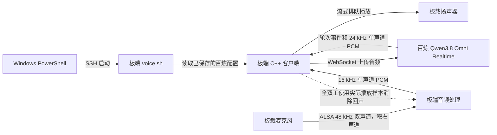

# 多轮语音对话

板端默认使用全双工，可在播报中插话。显式传入 `half-duplex` 时，等回复播完后继续听。同一次启动里的多轮对话共用一条 Qwen WebSocket，会话上下文由服务端维护。Linux 实录模式用 Ctrl+C 结束会话。

2026-11-12 已完成 Windows WAV 和板端实录两轮验证，现场确认扬声器在第二轮答出“蓝莓”。2026-11-13 用户确认实机全双工插话正常。实机记录保存在本机的 `docs/board/调试日志.md`。

## 当前语音流程



1. **启动会话。** `voice.sh` 从板端保存的配置读取 WebSocket 地址和 API Key。客户端连接 `qwen3.8-omni-flash-realtime`，用 `session.update` 设置语音和文字输出及 `server_vad`。收到 `session.updated` 后开始收音。
2. **上传和分轮。** 从 `aic3104` 采集 48 kHz 双声道 S16_LE，取右声道、低通并转为 16 kHz 单声道。客户端把音频编码为 Base64，通过 `input_audio_buffer.append` 持续上传。百炼检测开口和句尾，会话配置的句尾静音时间为 800 ms。每轮输入和回复留在同一云端会话里。
3. **回复和播放。** 百炼用 `response.audio.delta` 流式返回 24 kHz 单声道 PCM，板端解码后排队播放。终端的 `Microduck:` 显示模型回复转写。`response.done` 表示云端生成结束，声卡还可能在播放缓冲里的音频。

| 模式 | 板端如何录放 | 开口时发生什么 |
| --- | --- | --- |
| 默认全双工，也可传入 `live` 或 `full-duplex` | 录放句柄同时打开。回复转成 48 kHz 双声道后送声卡，实际写入声卡的样本作为 SpeexDSP 的回声参考。去回声和降噪后，板端按近期播放音量过滤输入，再上传。 | 收到百炼的 `speech_started` 时，若旧回复仍在生成或播放，立即清空应用队列和 ALSA 播放缓冲。云端仍在生成时发送 `response.cancel`，丢弃旧回复的迟到音频，继续接收用户的话。 |
| 显式 `half-duplex` | 检测到一轮结束后释放录音设备，播完再恢复收音。 | 看到下一条 `Listening` 后再追问。 |

终端出现 `Interrupted playback` 表示客户端已撤销旧播报。插话是否成功，要看用户说话后是否真的停播、后续回复是否理解了插话。断线后重启会建立新会话。Windows WAV 模式用文件替代麦克风和扬声器，主要用于回归验证。

## 1. 构建

需要 C++20、CMake、启用 WebSocket 的 libcurl 8.14 或更高版本、nlohmann/json 3.11 或更高版本。Linux 实录还需要 ALSA 开发包，全双工构建通过 pkg-config 启用 SpeexDSP。Debian 13 开发环境可用以下命令准备。

```sh
sudo apt-get install --no-install-recommends g++ cmake libcurl4-openssl-dev libasound2-dev nlohmann-json3-dev pkgconf libspeexdsp-dev
cmake -S . -B build/voice -DCMAKE_BUILD_TYPE=Release
cmake --build build/voice --parallel 2
```

Windows 从开发终端运行相同的 CMake 配置和构建命令。若用 MinGW 和官方 curl 二进制包，可在配置时传入 `-G "MinGW Makefiles"`、`-DCURL_NO_CURL_CMAKE=ON`、`-DCURL_INCLUDE_DIR=<curl>/include`、`-DCURL_LIBRARY=<curl>/lib/libcurl.dll.a` 和 `-DNLOHMANN_JSON_INCLUDE_DIR=<包含 nlohmann/json.hpp 的目录>`。运行时将对应的 libcurl DLL 放到可执行文件目录或 PATH。 [curl Windows 下载](https://curl.se/windows/)

## 2. 在 Windows 用模拟服务测试

```powershell
py -3.10 -m pip install "websockets==15.0.1"
py -3.10 tests/realtime_smoke.py build/voice/microduck-voice.exe
```

如果使用 Visual Studio 的多配置生成器，用实际输出目录中的可执行文件，例如 `build/voice/Release/microduck-voice.exe`。测试生成两段合成 WAV，在本机启动 WebSocket 服务，核对只有一次连接、48 kHz 输入取右声道、两个输出 WAV 的采样格式和样本。模拟服务使用确定性的回复。

使用 `-DMICRODUCK_TESTS=ON` 重新配置并构建后，可用 `py -3.10 tests/realtime_duplex.py build/voice/microduck-duplex-test.exe` 验证插话期间持续上传、取消竞争和旧音频过滤。

## 3. 连接 Qwen，先跑两段 WAV

在百炼控制台选择华北2（北京）或新加坡，打开 **API Key** 页面，在要使用的业务空间创建或复制 Key。在 **业务空间管理** 复制同一空间的 **API Host**，只取域名。若 Key 使用自定义模型权限，确认允许调用 `qwen3.8-omni-flash-realtime`。 [获取与配置 API Key](https://help.aliyun.com/zh/model-studio/get-api-key) · [Realtime 接入与 API Host](https://help.aliyun.com/zh/model-studio/omni-realtime-websocket-access)

客户端从当前终端的进程环境读取 `DASHSCOPE_API_KEY` 和 `DASHSCOPE_REALTIME_URL`，并将 URL 的 `model` 参数设为 `qwen3.8-omni-flash-realtime`。会话请求语音回复和 `server_vad`，沿用模型的 16 kHz 单声道 PCM 输入和 24 kHz PCM 输出。收到 `session.updated` 后才开始送音频。 [音频与事件格式](https://help.aliyun.com/zh/model-studio/client-events) · [服务端事件](https://help.aliyun.com/zh/model-studio/server-events)

每段 WAV 录一句话，使用 16 kHz 单声道或板端的 48 kHz 双声道 S16_LE。第二句可录“我刚才说自己叫什么？”，第一句则介绍一个名字。为每次运行选择新的输出目录。

```powershell
$bailianApiHost = (Read-Host '百炼 API Host').Trim()
$env:DASHSCOPE_REALTIME_URL = "wss://${bailianApiHost}/api-ws/v1/realtime?model=qwen3.8-omni-flash-realtime"
$env:DASHSCOPE_API_KEY = Read-Host -MaskInput '百炼 API Key'
.\build\voice-win\microduck-voice.exe --out ".local/validation/windows-$(Get-Date -Format yyyyMMdd-HHmmss)" --wav .local/qwen-demo/turn1.wav --wav .local/qwen-demo/turn2.wav
```

以上使用 PowerShell 7，在仓库根目录运行。本机已有 Windows 可执行文件和两段普通话合成语音。按实际构建目录和输入 WAV 调整路径。看到 `Listening (1)` 表示服务端已确认会话配置。依次听 `reply-1.wav` 和 `reply-2.wav`，确认第二轮正确引用第一轮。2026-11-12 的 Windows 回复归档在 `.local/validation/windows-2026-11-12-qwen38/`。测试完可以用 `Remove-Item Env:DASHSCOPE_API_KEY` 清理当前终端中的 Key。

若出现 `Set a WSS DASHSCOPE_REALTIME_URL and DASHSCOPE_API_KEY`，在运行程序的同一个终端重新执行上面的环境变量配置。其他启动错误会显示出错阶段，以及百炼返回的错误码、错误消息和请求 ID。

## 4. 在板端实录实放

当前板端已保存百炼配置，从 Windows 直接启动。

```powershell
ssh -t root@10.66.54.127 /root/microduck-voice/voice.sh
```

看到 `Listening (1)` 后对小鸭子说“我叫蓝莓，请记住我的名字”。等第一轮播完、终端出现 `Listening (2)` 后追问“我刚才说我叫什么？” 第二轮应从扬声器答出“蓝莓”。按 Ctrl+C 结束会话。

默认录放设备均为 `plughw:aic3104,0`。可通过 `MICRODUCK_CAPTURE_PCM` 和 `MICRODUCK_PLAYBACK_PCM` 选择其他 ALSA 设备。收音为 48 kHz 双声道，客户端取右声道低通后转为 16 kHz。断线后进程报错退出，重新启动会建立新会话。

### 全双工

板端全双工客户端使用 SpeexDSP 消除回声和降噪，按最近的扬声器参考音量判断插话。回声消除适应后，100 ms 内有 3 个 20 ms 帧符合条件即可保留插话，容许音节之间短暂变轻。使用约 100 ms 的缓冲保留语音开头，播放期间通过门槛的音频补偿约 6 dB。云端使用 `server_vad`，阈值为 `0.50`。可从 Windows 重跑硬件探测或显式启动全双工。

```powershell
ssh -t root@10.66.54.127 /root/microduck-voice/voice.sh probe-duplex
ssh -t root@10.66.54.127 /root/microduck-voice/voice.sh full-duplex
```

请小鸭子讲一个较长的故事，先保持安静听完，检查它是否自行开新一轮。再测播报时说“等一下，讲短一点”。确认旧声音停下、整句插话得到回复，且终端出现 `Interrupted playback`。如需量化回归，以平常音量测 10 次插话和 10 次无人插话对照。用同一录音中的波形标记用户起声和旧播报停止时刻，记录每次间隔。回归目标为至少 9 次成功、0 次自打断、至少 90% 的成功样本在 500 ms 内停播，最后复测两轮“蓝莓”。结果写入本机调试日志。

显式启动半双工可运行 `ssh -t root@10.66.54.127 /root/microduck-voice/voice.sh half-duplex`。被打断的旧回复可能留有云端已生成的内容。

### 语音触发地面起身

可以用模拟模式验证语音识别和延迟启动。从 Windows PowerShell 运行：

```powershell
ssh -t root@10.66.54.127 /root/microduck-voice/voice.sh standup --simulation
```

看到 `Listening (1)` 后说“请从地面站起来”。终端显示收到指令后，等待 1 秒开始模拟。成功显示 `动作结果 standup_simulated`。可用 Ctrl+C 退出。

实机模式去掉 `--simulation`。摆好地面姿态并在旁保护，再说起身指令。板端核对证书、站姿参考、串口及 15 路舵机的卸力状态，使用工作台已验证的地面起身流程。起身后保持零速平衡。结束操作时先托稳机身，再按 Ctrl+C。控制桥继续使用现有的实时电压、温度、电流及姿态保护。

起身测试期间，动作排队、执行和回复播放时对云端上传静音。等终端显示下一轮 `Listening` 再讲话。若百炼已丢弃某条动作回执，终端仍会显示板端结果，会话会继续监听。

### 语音起身后前进

在当前 Windows 工作台所在电脑双击 [启动语音起身前进.cmd](../MicroDuck%20工作台前后端/启动语音起身前进.cmd)。入口读回 15 路全部卸力后，暂停 Windows 关节采集，让同一个板端控制会话处理起身和前进。按 Ctrl+C 结束语音时，启动器会恢复采集并核对卸力。

1. 摆好地面姿态并在旁保护。看到 `Listening` 后说「请从地面站起来」，终端收到指令后等 1 秒开始起身。
2. 看到 `ready_to_walk` 和下一条 `Listening` 后，确认小鸭已站稳且前方空旷，再说「往前走」。等待期间保持零速平衡。
3. 收到前进指令后延迟 1 秒，控制器检查站稳状态后启用前进。前 4 秒的目标速度为 0.5 m/s，最后 1 秒平滑减速至零。
4. 看到 `forward_step_completed` 后，小鸭继续保持零速平衡。实际位移及停稳以现场观察为准。要结束测试时先托稳，再按 Ctrl+C。

故障和断连时按现有保护流程停机。需要独立测试语音协议时，在 SSH 终端运行 `voice.sh standup-walk --simulation`。

### 短动作候选版

候选入口是 `voice.sh control`。部署后，先由现有控制页按正常流程开启控制会话并确认独立站稳，控制会话启动时显式传入 `--voice-socket /run/microduck-voice/control.sock`。普通 `voice.sh` 继续用于全双工对话。

2026-11-14 已在板端隔离环境用伪终端和 `robotd --fake` 验证单次确认、到期归零和断线撤销。板端日常入口尚未切换到该候选。确认独立站稳后，控制桥会重新检查就绪状态，模拟中约需三秒。

1. 在 Windows 打开交互式 SSH 终端，运行 `ssh -t root@10.66.54.127 /root/microduck-voice/voice.sh control`。
2. 对小鸭子说“往前挪一小步”“向左转一点”或“向右转一点”。等待终端显示方向和时长。
3. 在同一终端输入 `确认` 并回车，限时 10 秒。也可让请求过期，或开口开始下一轮来撤销待确认请求。控制器完成本次指令并回执归零后，终端显示 `动作结果 completed`。实际位移和停稳以现场观察为准。

前进速度为 0.05 m/s，转向角速度为 0.20 rad/s，预设时长为 0.4 秒，两次动作起点至少间隔 3 秒。手动驾驶接管时撤销语音动作，断线撤销语音指令。离线语音停步留待后续。实机跑动须经用户允许。

板端候选按 [部署参考](../skills/microduck-code-update/references/board-deployment.md#语音动作候选) 准备。Windows 测试可运行 `py -3.10 -B tests/test_voice_control.py` 和 `py -3.10 -B tests/realtime_motion.py build/voice-win/microduck-duplex-test.exe`。

### 首次配置或更换 Key

如果 Windows 的 PowerShell 会话已设置百炼 URL 和 Key，可以经 SSH 一次写入板端。

```powershell
@($env:DASHSCOPE_REALTIME_URL, $env:DASHSCOPE_API_KEY) | ssh -T root@10.66.54.127 /root/microduck-voice/voice.sh configure --stdin
```

也可以在板端终端直接配置一次。输入 API Host 域名和 Key。板端将配置保存在 `/root/.config/microduck-voice/bailian.conf`，文件权限为 `0600`。

```bash
/root/microduck-voice/voice.sh configure
```

看到 `Saved board configuration` 后，用上面的启动命令开始对话。
