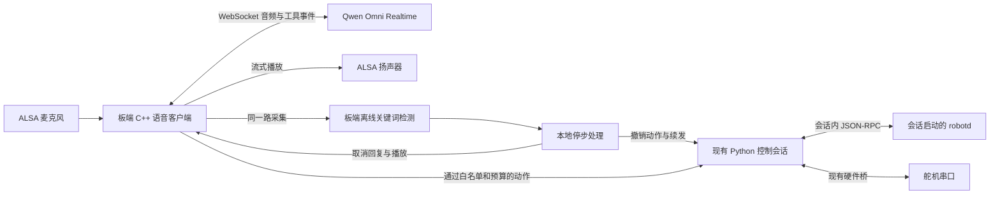

# Microduck 语音交互执行方案

## 用户可以做什么

| 功能       | 用户可以这样说                   | 机器人应该怎样回应                                                      | 交付状态                 |
| -------- | ------------------------- | -------------------------------------------------------------- | -------------------- |
| 自然语音对话   | “我叫蓝莓，请记住我的名字”“我刚才说我叫什么？” | 流式语音回答。在同一会话内理解追问。用户手动开启或结束会话，Qwen 自动判断每轮说话结束。                 | Windows WAV 和板端实录均通过 |
| 本地语音停步   | “停下”“别动”或 “stop”          | 板端识别后撤销语音和手动移动，并清空正在播放的回复。动作控制侧将速度指令归零。 | 后续阶段 |
| 确认后执行短动作 | “往前挪一小步”“向左转一点”           | 终端显示方向和时长，在 10 秒内输入 `确认` 并回车后执行一次预设动作，到时归零。 | Windows 和板端模拟已通过 |
| 语音触发地面起身 | “请从地面站起来” | 延迟 1 秒按工作台的受扶持配置起身，持续尝试直到站稳或保护停止。 | 2026-11-15 用户现场确认通过 |
| 起身后语音前进 | “往前走” | 站稳后接到前进请求，等 1 秒再启动。前进最高 0.5 m/s，共 5 秒，最后 1 秒平滑归零并保持平衡。 | 2026-11-15 用户确认前进通过，完整自动减速和停稳时间待留档 |
| 播报中插话    | “等一下，讲短一点”                | 全双工收音与回声消除持续运行。Qwen 检测到开口后，板端停止旧播报，同一会话接收插话并续答。                | 用户确认实机正常，板端默认启用      |
| 表情动作     | “点点头”“看左边”                | 通过定制控制路径验证头部动作后开放对应工具。                                         | 后续扩展                 |

当前可演示**对板载麦克风说话 → 听到扬声器回复 → 追问并得到与上一轮相关的答复**。完成实机动作阶段后，再演示**口头提出短动作 → 本地确认 → 走一步或短转 → 本地语音停步**。其中“小步”表示有速度和时长上限的动作，实际移动距离取决于步态和地面。 [运行指南](多轮语音对话.md)

## 目标架构

板载录音、云端多轮对话和播放已接通，板端默认支持全双工插话。下面是加入工具事件、本地关键词检测和语音动作后的目标架构。 [当前语音流程](多轮语音对话.md#当前语音流程)

- **音频。** 用 `plughw:aic3104,0` 采集 48 kHz、S16_LE 双声道，取右声道后转为 16 kHz 单声道。默认全双工同时录放，以扬声器参考做回声消除，收到云端开口事件时可停止旧播报。显式半双工在播放前释放录音设备，播完再恢复。接入本地停词时，需要验证播放期间的关键词识别。
- **实时协议。** 板端读取已保存的百炼配置，以 `qwen3.8-omni-flash-realtime` 和 `server_vad` 建立会话，按模型输出格式播放。工具接入后，收到 `response.function_call_arguments.done` 再解析参数，按会话和 `call_id` 去重。通过对应 `call_id` 的 `function_call_output` 回填结果，再用 `response.create` 请求续答。
- **本地工具契约。** Qwen 只可申请 `move_short`，方向为前进、左转或右转。速度和时长由控制端预设。执行层校验工具名、参数、会话状态和动作预算，一次只允许一个短动作。终端输入 `确认` 时由客户端绑定当前申请，有效期结束后重新申请。
- **实机入口。** C++ 以普通客户端连接现有控制会话的受限 Unix socket。`run_teleop.py` 持有 `/dev/ttyS2`，应用软件零位和硬件保护，并启动会话自己的定制 `robotd`。控制就绪检查由现有会话执行。用 `voice.sh control` 开启动作功能，实际运动验证须经用户允许。
- **停止语义。** 当前候选在云端断连或动作到期时停止续发语音速度，由控制循环恢复零速度或交还手动控制。后续本地停词命中时，要撤销语音和手动移动，再调用 `robot.stop`，保持平衡控制。控制页的 `off` 负责卸力。底层 deadman 负责速度指令停止刷新后的归零。

## 实施步骤

| 步骤 | 实施内容 | 交付和验证 |
| --- | --- | --- |
| 1. Windows 对话 | 用双声道 WAV 验证右声道提取、重采样和多轮会话。 | 已通过模拟测试及真实百炼双轮 WAV 测试。 |
| 2. 板端语音闭环 | 构建 Linux ARM64 程序，接入 ALSA、TLS/WebSocket 和 Qwen。用板载麦克风和扬声器完成多轮对话。 | 2026-11-12 现场通过。后续可记录说完到首次出声的 P50/P95。 |
| 3. 模拟控制联调 | Windows 验证工具协议、动作状态机和手动接管。ARM64 用独立 socket 启动 `robotd --fake`，验证终端确认、到期归零与断线撤销。 | Windows 和板端模拟通过。 |
| 4. 受控实机联调 | 获得用户允许后，通过现有控制会话测试预设短动作、到期归零、断网和手动接管。 | 核对控制归属、速度回执及现场表现。 |
| 5. 本地语音停步 | 在全双工录音链路接入本地关键词识别。 | 记录关键词命中到速度指令归零及机体实际停稳的时间。 |

首轮测试记录同时保留环境和模型配置。重点采样安静、扬声器播放、舵机运行三种场景下的本地停词命中与误触发。回复依据控制端状态区分“指令已接受”“动作已完成”和“结果未知”。停步的实际效果以控制遥测和现场观察为准。

## 当前验证状态

2026-11-12 现场确认小鸭子的扬声器在第二轮答出“蓝莓”，板载收音、百炼云端上下文接续和板载播放已通过验收。百炼配置已保存到板端。

2026-11-13 全双工通过 Windows 和 ARM64 模拟测试、板端 60 秒静音同时录放及百炼会话配置验证。实际板载播报期间混入合成近端语音后，百炼 `server_vad` 检出三次插话，纯回声对照未触发。用户随后确认真人插话正常，板端已切换为默认全双工。现场误触发率和停播延迟暂无量化记录。 [运行指南](多轮语音对话.md#全双工)

2026-11-14 短动作候选通过 Windows 模拟、ARM64 构建及板端 `robotd --fake`。板端伪终端输入 `确认` 后发出一次预设模拟动作，到期收到归零回执，断线撤销待确认请求。候选仍在板端隔离目录。 [短动作候选版](多轮语音对话.md#短动作候选版)

- 板端环境和调试日志保存在本机的 `docs/board/`。 [板端部署参考](../skills/microduck-code-update/references/board-deployment.md)
- 工作台的实机起身和遥测操作见 [Windows 实机工作台](../MicroDuck%20工作台前后端/使用说明.md#windows-实机工作台)。
- [Qwen WebSocket 交互流程](https://help.aliyun.com/zh/model-studio/omni-realtime-interaction-process) · [Qwen 客户端事件](https://help.aliyun.com/zh/model-studio/client-events)
- [Quacksat Agent 协议](https://github.com/andreagenovese/quacksat/blob/c3c54b0c4faae9a8360178a604c129057868e92b/docs/agent-protocol.md) · [quackd .duck 契约](https://github.com/rokbenko/quackd/blob/e68aed41c84d27970e81f60f5e21eed38a8d80de/docs/reference/duck-spec.md) · [Companion 停步参考](https://github.com/GC-RENCAO/microduck-companion/blob/b9dc1f00a0e769efeebd8ac1658bbb09915b4ac7/server.py#L81)
